<section id="content">

# <a id="works_ru" href="#works_ru">👨🏻‍💻 Опыт работы</a>

* ### TeamLead CV / Руководитель команды разработки

    *2024-2026 [ООО «Лаборатория Наносемантика»](https://nanosemantics.ai/)*

    * TeamLead отдела DataScience. Руководил командой из пяти Data Science и нескольких бэкенд разработчиков и инженеров
    * Завершил и вывел в прод 6 крупных проектов (NDA), включающих такие области как Object detection, OCR, RAG.
    * Обучил команду лучшим практикам разработки, вводил регламенты и стандарты, которые повысили качество кода и снизили нагрузку на другие отделы
    * Выстроил более прозрачную и понятную систему рабочих взаимодействий технических специалистов
    * Computer Vision, PyTorch,  NLP, RAG, FastAPI

#### ⠀

* ### Python-разработчик, инженер DL, DevOps

    *2020-2024 [Лаборатория инженерной физики МГУ](https://engineering.phys.msu.ru/ru/)*
    
    * Разрабатывал нейросетевое ПО для автоматической системы сигнатурного анализа компонентов на печатных платах (PyTorch, Qt)
    * Улучшал алгоритмы управления оптомеханическими приводами
    * Разворачивал многоплатформенный кластер виртуальных машин для внутренних пайплайнов сборки и тестирования (Jenkins)

#### ⠀

* ### Data Scientist и backend-разработчик
    *2023-2024 [Business process audit](https://www.bpa.tech/)*

    * [Статья на хабре](https://habr.com/ru/articles/887422/). Реализовал полный цикл разработки real-time computer vision системы для мониторинга офисных помещений по камерам видеонаблюдения
    * Организовывал сбор и разметку данных, обучил модель, разработал API, контролировал frontend и выводил в production
    * Реализовал интеграцию нескольких Telegram-ботов с системой

#### ⠀

* ### Deep Learning инженер

    *2023-2024 Московский физико-технический институт. [Лаборатория при ФАЛТ](https://mipt.ru/education/schools/rse)*
    
    * Создал и обучил модель для анализа эхолокационных изображений
    * Разрабатывал систему автоматизации для помощи оператору эхолокатора
    * Система распознавания объектов помогала оператору быстрее и точнее обнаруживать объекты на снимках

#### ⠀

* ### Преподаватель курса по нейронным сетям

    *2020-2022 [MSU.AI](https://msu.ai) (МГУ имени М.В.Ломоносова)*

    * Написал и преподавал годовой курс по нейронным сетям аспирантам и магистрам МГУ.
    * Курс охватывал широкий спектр типов нейронных сетей и методов их обучения, а так же обширную практику.
    * Выступал научным консультантом при написании аспирантами и магистрами статей с использованием нейронных сетей

#### ⠀

* ### Руководитель команды разработчиков PWA-приложения

    *2021-2023 Community Hub*

    * Собрал команду разработки из 30 человек
    * Консультировал и участвовал в разработке PWA приложения для студентов, которым пользуется ~2500 человек.
    * Разработал микросервисную архитектуру (Docker, Python, Fast-API, Kafka, Type-script, PostgreSQL и другие)

# <a id="education_ru" href="#education_ru">🎓 Образование</a>

* ### (МГУ) Московский государственный университет имени М.В.Ломоносова
    (2018-2022, Москва) Бакалавриат, Физический факультет, отделение ядерной физики

* ### (МФТИ) Московский физико-технический институт
    (2022-2024, Долгопрудный) Магистратура, Физтех-школа прикладной математики и информатики

# <a id="skills_ru" href="#skills_ru">🛠️ Hard skills</a>

* ### Основной стек
    Python, PyTorch, TensorFlow, NumPy, Matplotlib, Pandas, OpenCV, FastAPI, Docker, Jupyter Notebook — Разработка нейросетевых решений, бэкенда, анализ данных.
    

      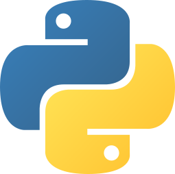
      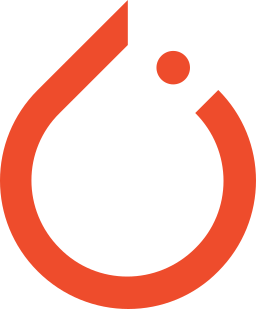
      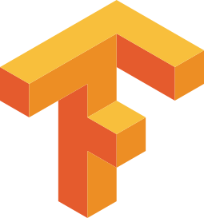
      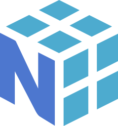
      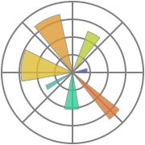
      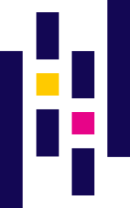
      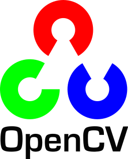
      
      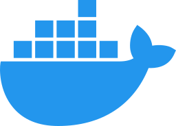
      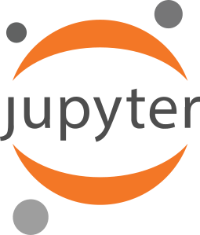
    

* ### Дополнительный стек
    PostgreSQL, C++, Javascript, Qt, HTML, CSS, jQuery, Boootstrap, GraphQL, Arduino — Разработка сайтов, графических интерфейсов нативных приложений, прошивки микроконтроллеров.
    

      
      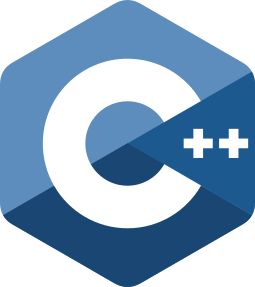
          
      
      
      
      
      
      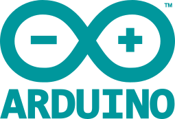
  

* ### Другое
    Linux, Jenkins, VirtualBox, Vagrant, Git, Mercurial, GitHub, GitLab, GraphQL, Groovy — CI/CD, DevOps, разработка различных автоматизациий, пайплайнов, развёртывания.
    

      
      
       
      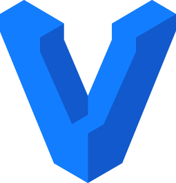
      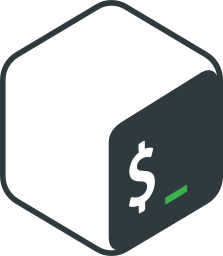
      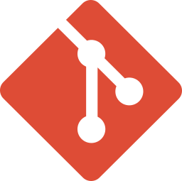
      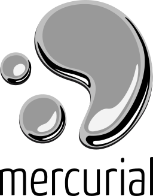
      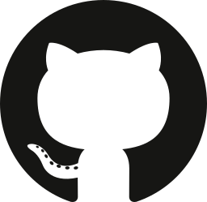
      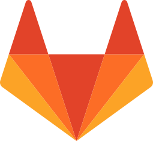
      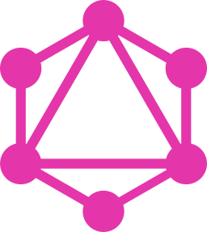
      
    

# <a id="projects_ru" href="#projects_ru">🧩 Публичные проекты </a>
Публичных проектов не много, т.к. в основном коммичусь в приватные гитлабы.
* **[Neural networks course](https://github.com/EPC-MSU/EduNet-lectures)** - Курс для аспирантов и магистров МГУ
* **[Github Issue Telegram Bot](https://github.com/annndruha/issue-github-telegram-bot)** - Бот для создания issue в GitHub из чата в Telegram
* **[Faculty application](https://github.com/profcomff)** - Приложение для студентов физического факультета МГУ
* **[EPC-MSU/epdetection](https://github.com/EPC-MSU/epdetection)** - Модуль распознавания компонентов на печатной плате
* **[PulchraBookmarks](https://chrome.google.com/webstore/detail/pulchra-bookmarks/pknkgclggganidoalifaagfjikhcdolb)** - Расширение-закладки для Chrome
* **[SecurePhotos](https://github.com/annndruha/SecurePhotos)** - Галерея для фото с шифрованием

# <a id="contacts_ru" href="#contacts_ru">📧 Контакты</a>
* Телеграм: [@annndruha](https://t.me/annndruha)
* Почта: [annndruha.github@gmail.com](mailto:annndruha.github@gmail.com)
* Профиль на [GitHub](https://github.com/annndruha)

</section>
<section id="second_content">

# <a id="works" href="#works">👨🏻‍💻 Work experience</a>

* ### TeamLead CV | Deputy Head of Machine Learning Department

    *2024-2026 [Nanosemantics Lab](https://nanosemantics.ai/)*

    * Team Lead of the Data Science department. Managed a team of five Data Scientists and several backend developers and engineers
    * Completed and brought to production 6 major projects (NDA) spanning areas such as Object Detection, OCR, and RAG
    * Trained the team in development best practices; introduced regulations and standards that improved code quality and reduced the workload on other departments
    * Established a more transparent and clearer system of work interactions among technical specialists
    * Computer Vision, PyTorch, NLP, RAG, FastAPI
  
* ### Deep Learning Engineer, Python developer

    *2020-2024 [Center of Engineering Physics](https://engineering.phys.msu.ru/ru/) at Lomonosov Moscow State University*

    Working on “EyePoint P10” - a signature analysis system. EyePoint P10 aims to detect faulty electronic components on printed circuit boards. Deployed a cluster of virtual machines for internal build and testing pipelines (Jenkins) - an analogue of GitHub Actions.
  
* ### Data Scientist and backend-developer
    *2023-2024 [Business process audit](https://www.bpa.tech/)*

    Developed an applied neural network solution for monitoring office premises using CCTV cameras. Carried out the full development cycle (except for the frontend): from collecting and annotate data to deploying the real-time backend of the trained model.
  
* ### DL-engineer

    *2023-2024 Moscow Institute of Physics and Technology*

    For a short time I worked in a [laboratory](https://mipt.ru/education/schools/rse) engaged in the analysis of echolocation images. My main task was to process data and apply object detection models such as YOLO.

* ### Teacher of neural networks courses

    *2020-2022 Lomonosov Moscow State University*

    I teach a one-year Neural Networks course for postgraduate MSU students. [The course](https://msu.ai) covers a wide range of neural networks types, deals with solving various problems. In the second part of the course, students did implement neural networks in their scientific work under my guidance

* ### Ideological mastermind of the faculty application

    *2021-2023 MSU Faculty of Physics*

    With friends, created a community of volunteer programmers of MSU Faculty of Physics. With team, we developed [PWA application](https://app.profcomff.com/apps) for students and teachers of the faculty, which is used by almost the entire faculty. The application consists of many modules covering a large stack of technologies like: databases, servers, APIs, auth, frontend, backend, analytics.

# <a id="education" href="#education">🎓 Education</a>

* ### Lomonosov Moscow State University
    (2018-2022, Moscow) Bachelor's degree in "Physics", Faculty of Physics, Department of particles physics

* ### Moscow Institute of Physics and Technology
    (2022-2024, Dolgoprudny) Master's degree in Applied Mathematics and Computer Science, Department of Technologies of Digital Transformation

# <a id="skills" href="#skills">🛠️ Hard skills</a>

* ### Primary stack
    Python, PyTorch, TensorFlow, NumPy, Matplotlib, Pandas, OpenCV, FastAPI, Docker, Jupyter Notebook — Deep learning solutions, backend, data analysis.
    

      
      
      
      
      
      
      
      
      
      
    

* ### Secondary stack
    PostgreSQL, C++, Javascript, Qt, HTML, CSS, jQuery, Boootstrap, GraphQL, Arduino — Sites, GUI, microcontrollers firmware.
    

      
      
          
      
      
      
      
      
      
  

* ### Other
    Linux, Jenkins, VirtualBox, Vagrant, Git, Mercurial, GitHub, GitLab, GraphQL, Groovy — CI/CD, DevOps, automatization, pipelines.
    

      
      
       
      
      
      
      
      
      
      
      
    

# <a id="projects" href="#projects">🧩 Open source projects </a>
* **[Neural networks course](https://github.com/EPC-MSU/EduNet-lectures)** - NN course for postgraduate MSU students
* **[GitHub Issue Telegram Bot](https://github.com/annndruha/issue-github-telegram-bot)** - Bot for creation GitHub issue straight from Telegram group chat
* **[Faculty application](https://github.com/profcomff)** - Timetable, printers, lectures, bots, services
* **[EPC-MSU/epdetection](https://github.com/EPC-MSU/epdetection)** - Module to detect PCB components by neural network
* **[PulchraBookmarks](https://chrome.google.com/webstore/detail/pulchra-bookmarks/pknkgclggganidoalifaagfjikhcdolb)** - Chrome extension for newtab
* **[SecurePhotos](https://github.com/annndruha/SecurePhotos)** - Photo gallery with encryption

# <a id="contacts" href="#contacts">📧 Contacts</a>
* Telegram: [@annndruha](https://t.me/annndruha)
* Mail: [annndruha.github@gmail.com](mailto:annndruha.github@gmail.com)
* Profile on [GitHub](https://github.com/annndruha)

</section>
